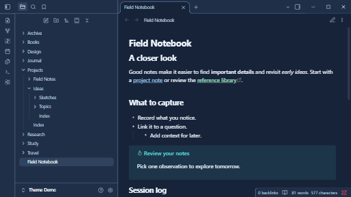
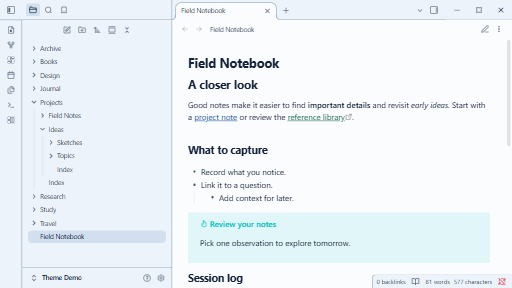

# Pocket Mobile

An Obsidian theme designed around phone screens and touch navigation.

Source version 3.6.0. Modes supported: Dark and light. Tested in Obsidian 1.15.1 on Windows.

The compact layout targets the mobile interface. Device compatibility has not been verified on physical Android or iOS devices.

## Preview

## Install manually

1. Download `manifest.json` and `theme.css` from [release 1.0.0](https://github.com/tutivsoft-com/obsidian-theme-pocket-mobile/releases/tag/1.0.0).
2. Put both files in `.obsidian/themes/Pocket Mobile/` in your vault.
3. Open **Settings > Appearance** and select **Pocket Mobile**. Choose a supported base colour scheme.

See the [original design plan](PLAN.md). [MIT license](LICENSE).
